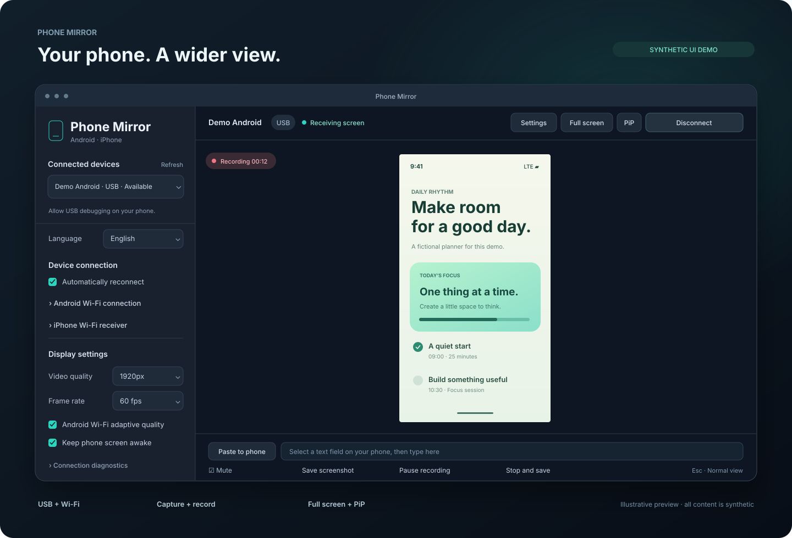

<div align="center">


# Phone Mirror

**폰 화면을, 더 넓게.**

Android와 iPhone 화면을 데스크톱으로 가져오세요.<br>
넓은 화면에서 연결하고, 캡처하고, 녹화하고, 입력하세요.

[](https://github.com/JungSeunghun/phone/actions/workflows/desktop.yml)
[](LICENSE)
[](#주요-기능)

[빠른 시작](#빠른-시작) · [지원 상태](#지원-상태) · [문서](#문서) · [English](README.md)

</div>



<p align="center"><sub>합성 내용으로 만든 데스크톱 UI 일러스트입니다. 실제 폰 화면 캡처나 실기기 검증 증거가 아닙니다.</sub></p>

## 주요 기능

- **원하는 방식으로 연결.** Android USB·Wi-Fi, QR·코드 페어링, 자동 재연결을 지원합니다. iPhone은 macOS 네이티브 USB 캡처 또는 별도 송출 앱을 사용합니다.
- **컴퓨터에서 편하게 조작.** Android를 마우스·키보드로 조작하고, 텍스트를 붙여 넣거나 다국어 입력기의 확정된 글자를 전송할 수 있습니다. iPhone 텍스트 입력에는 별도의 암호화된 키보드 연결을 사용합니다.
- **필요한 순간을 저장.** PNG 캡처와 MP4 녹화를 지원하며, 녹화·일시정지 중에도 캡처할 수 있습니다. 기기와 앱이 허용하는 경우 폰 소리도 재생·녹화합니다.
- **내게 맞는 작업 화면.** 전체 화면, PiP, 한국어·영어 UI를 제공합니다. 언어 변경은 즉시 적용되고 재실행 후에도 유지됩니다.

## 지원 상태

기본 데스크톱 앱은 **macOS 14 이상과 Windows**를 대상으로 합니다. 구현 여부와 실기기 검증 상태는 구분합니다.

| 폰과 컴퓨터              | 연결        | 검증 상태                                                    |
| ------------------------ | ----------- | ------------------------------------------------------------ |
| Android · macOS          | USB · Wi-Fi | 실기기 미러링·미디어 검사 완료, 다국어 입력은 Wi-Fi에서 검증 |
| Android · Windows        | USB · Wi-Fi | 구현 및 자동 검사, Windows 네이티브·실기기 검증 대기         |
| iPhone · macOS / Windows | USB · Wi-Fi | 수신·송출 경로 구현, iPhone 실기기 검증 대기                 |

컴퓨터·연결 방식별 차이는 [전체 지원 표](docs/SUPPORT.md)를 확인하세요. iPhone 마우스·터치 조작은 구현하지 않았습니다. 텍스트 입력에는 Phone Mirror 키보드, 전체 접근 허용, 로컬 네트워크 연결, 호환되는 입력칸이 필요합니다. 소리 수신 여부는 운영체제·앱·보호 콘텐츠 정책에 따라 달라집니다.

**배포 상태:** 설치 파일과 서명된 업데이트는 [GitHub Releases](https://github.com/JungSeunghun/phone/releases)로 배포합니다. 0.2.2부터 공식 업데이트 피드를 기본 연결하며, 0.2.0에서는 [배포 안내](desktop/RELEASING.md)의 주소를 직접 등록하세요. 현재 개발용 설치 파일은 Mac ad-hoc 서명·미공증, Windows 게시자 코드 서명 없음 상태이며 업데이트 파일의 서명 검증은 적용됩니다.

## 빠른 시작

### 소스에서 실행

**Node.js 22**, **Rust 1.90 이상**, [Tauri 플랫폼 빌드 도구](https://v2.tauri.app/start/prerequisites/)가 필요합니다. Android 연결에는 Android SDK Platform Tools 전체 폴더를 설치하고 `adb`가 `PATH`에서 검색되도록 설정하세요.

```sh
cd desktop
npm ci
npm run tauri dev
```

macOS 빌드에는 Xcode Command Line Tools가 필요합니다. Windows 빌드에는 MSVC C++ Build Tools와 Windows SDK, 앱 실행에는 WebView2가 필요합니다.

### 첫 번째 폰 연결

1. **Android USB:** 데이터 케이블 연결 → USB 디버깅 설정 → 폰에서 컴퓨터 승인 → USB 기기 선택 → **폰 화면 보기**.
2. **Android Wi-Fi:** 같은 네트워크에서 Android 11 이상 무선 디버깅을 켜고 **Android Wi-Fi 연결**을 여세요. QR·코드로 페어링한 뒤 폰의 연결 포트를 사용하세요. 페어링 포트와 연결 포트는 다릅니다.
3. **iPhone:** [송출 앱·키보드 설정](ios/README.md)을 따라 연결하세요. Mac 네이티브 USB 캡처는 잠금 해제·컴퓨터 신뢰·카메라 권한이 필요합니다. Windows USB와 Wi-Fi 수신은 송출 앱의 화면 방송을 사용합니다.

앱의 **처음 연결하기**에서 연결별 단계를 안내합니다. 저장된 기기를 앱 실행 시 자동으로 미러링하지 않습니다. 설정의 **언어 / Language**에서 **한국어** 또는 **English**를 선택할 수 있습니다.

## 문서

| 안내                                                             | 내용                                  |
| ---------------------------------------------------------------- | ------------------------------------- |
| [데스크톱 설정](desktop/README.md)                               | 연결·입력·미디어·빌드·문제 해결       |
| [iPhone 설정](ios/README.md)                                     | 송출 앱·화면 방송·키보드 확장         |
| [지원 표](docs/SUPPORT.md)                                       | 플랫폼별 기능과 검증 범위             |
| [패키징·업데이트](desktop/RELEASING.md)                          | 로컬 설치 파일과 서명된 업데이트 배포 |
| [기여 안내](CONTRIBUTING.md)                                     | 개발 검사·TDD·커밋 규칙               |
| [구조 설명](docs/ARCHITECTURE.md) · [개선 계획](docs/ROADMAP.md) | 프로젝트 구성과 예정 작업             |
| [검증 기록](desktop/TESTING.md)                                  | 자동 검사·네이티브 실행·실기기 증거   |
| [기존 Swift 앱](docs/SWIFT_APP.ko.md)                            | 별도로 유지하는 네이티브 macOS 앱     |

기본 앱은 `desktop/`의 **Rust + Tauri + React** 앱입니다. 기존 Swift macOS 앱은 `Sources/`, 선택적으로 사용하는 iPhone 송출 앱과 키보드 확장은 `ios/`에 있습니다.

## 개인정보와 문제 신고

운영체제, 앱 버전, 폰 OS, 연결 방식, 재현 단계와 검증 환경을 함께 알려주세요. 앱의 **연결 문제 진단 → 진단 요약 저장**은 정해진 점검 결과만 내보냅니다. JSON 내용을 확인한 뒤 이슈에 첨부하세요.

실제 폰 화면·녹화·클립보드 내용·연결 코드·검토하지 않은 로그는 공개 이슈에 올리지 마세요. 공개 데모에는 [미리보기 일러스트](docs/assets/README.md)처럼 합성 내용을 사용합니다. 보안 문제는 [SECURITY.md](SECURITY.md)를 통해 신고하세요.

## 라이선스

프로젝트 자체 코드는 [MIT](LICENSE), 외부 코드와 라이브러리는 각각의 원래 라이선스를 따릅니다. scrcpy는 Apache-2.0 라이선스를 사용합니다. [외부 라이선스 고지](THIRD_PARTY_NOTICES.md)를 확인하세요.
